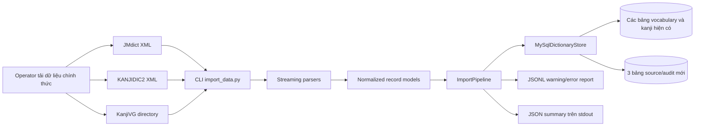

# JLAS2-19 - Báo cáo triển khai và hướng dẫn vận hành Dictionary/Kanji Base Data Import

## 1. Thông tin tài liệu

| Mục | Giá trị |
|---|---|
| Jira | `JLAS2-19` - Build Dictionary/Kanji Base Data Import & Log |
| Nhánh triển khai | `feat/JLAS2-19-dictionary-kanji-base-data-import-log` |
| Commit cuối tại thời điểm viết | `0f47c30 fix: harden dictionary import edge cases` |
| Ngày kiểm chứng | 2026-09-16 |
| Mục đích tài liệu | Giải thích chi tiết phần đã triển khai, cách vận hành và cung cấp checklist để người khác review |
| Phạm vi vận hành | Import dữ liệu nền JMdict, KANJIDIC2 và KanjiVG vào MySQL bằng lệnh thủ công |

Tài liệu này là tài liệu bàn giao kỹ thuật. Người review nên đọc tài liệu này trước, sau đó đối chiếu trực tiếp với migration, mã nguồn importer và test được dẫn ở từng phần.

## 2. Tóm tắt ngắn gọn: chức năng này giải quyết vấn đề gì?

Trước thay đổi này, database đã có các bảng từ vựng và Kanji như `vocabulary_entry`, `vocabulary_reading`, `vocabulary_variant`, `vocabulary_sense`, `vocabulary_gloss`, `kanji`, `kanji_reading`, `vocabulary_kanji`, nhưng chưa có một quy trình chính thức để:

1. Đọc dữ liệu từ các bộ dữ liệu chuẩn JMdict, KANJIDIC2 và KanjiVG.
2. Chuẩn hóa dữ liệu tiếng Nhật trước khi chống trùng.
3. Ghi dữ liệu vào đúng các bảng hiện có.
4. Không làm mất dữ liệu giáo trình đã được biên soạn trong J-LAS.
5. Chạy lại an toàn mà không tạo dữ liệu trùng.
6. Ghi lại nguồn, phiên bản, checksum, trạng thái và số lượng bản ghi của mỗi lần import.
7. Cho phép một record lỗi nhưng các record hợp lệ khác vẫn được nhập.
8. Cung cấp báo cáo lỗi đủ để truy vết mà không làm lộ password/token.

Phần triển khai mới bổ sung một CLI Python chạy thủ công. Đây không phải API, không phải màn hình quản trị, không phải cron job và không tự chạy khi Spring Boot khởi động.

## 3. Phạm vi đã làm và không làm

### 3.1. Đã làm

- Thêm đúng ba bảng metadata/audit phục vụ import.
- Seed ba nguồn dữ liệu `JMDICT`, `KANJIDIC2`, `KANJIVG` và thông tin license.
- Xây dựng streaming parser cho JMdict và KANJIDIC2.
- Xây dựng parser ánh xạ file KanjiVG sang URI SVG.
- Chuẩn hóa expression, reading, romaji và ký tự radical.
- Import vocabulary, readings, variants, senses, glosses, POS, domains và quan hệ vocabulary-Kanji.
- Import Jōyō Kanji, radical, số nét và ON/KUN/NANORI readings.
- Merge an toàn với vocabulary thuộc giáo trình.
- Chống trùng theo external ID và natural key.
- Kiểm soát transaction theo chunk và savepoint theo record.
- Hỗ trợ dry-run, JSON summary và JSONL error report.
- Bổ sung unit test, schema test và MySQL integration test tùy chọn.
- Viết tài liệu nguồn dữ liệu, license và câu lệnh vận hành.

### 3.2. Không làm

- Không xây dựng UI tìm kiếm từ điển.
- Không xây dựng REST API mới.
- Không tự tải dữ liệu qua mạng trong lúc ứng dụng chạy.
- Không đăng ký `ApplicationRunner`, `CommandLineRunner` hay `@Scheduled` để tự import.
- Không lưu nội dung SVG vào MySQL.
- Không machine-translate gloss sang tiếng Việt.
- Không scrape Mazii, Jisho hoặc từ điển thương mại.
- Không tự xóa sense/gloss cũ khi upstream loại bỏ chúng.
- Không thêm bảng ngoài ba bảng metadata đã được yêu cầu.

## 4. Kiến trúc sau khi triển khai



Trách nhiệm được chia thành các lớp độc lập:

| Thành phần | File | Trách nhiệm |
|---|---|---|
| Entry point | `scripts/dictionary_import/import_data.py` | Thêm repository root vào Python path và gọi CLI |
| CLI | `jlas_import/cli.py` | Đọc tham số, kiểm tra input/env, tính checksum, kết nối MySQL, chọn parser và in summary |
| Models | `jlas_import/models.py` | Các record trung gian độc lập với database |
| Normalization | `jlas_import/normalization.py` | NFKC, whitespace, Kana và Hepburn romaji |
| Parsers | `jlas_import/parsers.py` | Streaming JMdict/KANJIDIC2 và ánh xạ KanjiVG |
| Pipeline | `jlas_import/pipeline.py` | State machine, counters, transaction boundary và lỗi |
| Store | `jlas_import/store.py` | Prepared SQL, upsert, merge textbook và ghi audit |
| Reporting | `jlas_import/reporting.py` | Ghi UTF-8 JSON Lines cho warning/error |

## 5. Những file đã thêm hoặc sửa

### 5.1. Database

- `jlas_schema.sql`: đưa ba bảng mới và source seed vào schema đầy đủ dành cho database mới.
- `sql/migrations/058_dictionary_import_metadata.sql`: migration cộng thêm dành cho database hiện hữu.
- `src/test/java/com/jlas/dictionary/importer/DictionaryImportSchemaTest.java`: chạy migration bằng H2 MySQL mode và kiểm tra tables/constraints.

### 5.2. Importer

- `scripts/dictionary_import/import_data.py`
- `scripts/dictionary_import/requirements.txt`
- `scripts/dictionary_import/jlas_import/__init__.py`
- `scripts/dictionary_import/jlas_import/cli.py`
- `scripts/dictionary_import/jlas_import/models.py`
- `scripts/dictionary_import/jlas_import/normalization.py`
- `scripts/dictionary_import/jlas_import/parsers.py`
- `scripts/dictionary_import/jlas_import/pipeline.py`
- `scripts/dictionary_import/jlas_import/reporting.py`
- `scripts/dictionary_import/jlas_import/store.py`

### 5.3. Test và fixture

- `scripts/dictionary_import/tests/test_cli.py`
- `scripts/dictionary_import/tests/test_normalization.py`
- `scripts/dictionary_import/tests/test_jmdict_parser.py`
- `scripts/dictionary_import/tests/test_kanji_parsers.py`
- `scripts/dictionary_import/tests/test_pipeline.py`
- `scripts/dictionary_import/tests/test_store.py`
- `scripts/dictionary_import/tests/test_mysql_integration.py`
- `scripts/dictionary_import/tests/mysql_test_schema.sql`
- Các XML/SVG fixture nhỏ trong `scripts/dictionary_import/tests/fixtures/`.

### 5.4. Tài liệu và ignore rules

- `docs/dictionary-import.md`: hướng dẫn vận hành ngắn bằng tiếng Anh.
- `docs/superpowers/specs/2026-09-15-dictionary-kanji-import-design.md`: quyết định thiết kế.
- `docs/superpowers/plans/2026-09-15-dictionary-kanji-import.md`: kế hoạch triển khai từng bước.
- `.gitignore`: bỏ qua virtual environment, Python cache, report và dữ liệu upstream dung lượng lớn.

## 6. Thay đổi database chi tiết

### 6.1. Bảng `dictionary_source`

Mục đích: quản lý danh mục nguồn import được phép sử dụng.

| Cột | Ý nghĩa |
|---|---|
| `id` | Primary key |
| `code` | Mã nguồn ổn định; unique, ví dụ `JMDICT` |
| `name` | Tên hiển thị |
| `source_url` | Trang chính thức của nguồn |
| `license_name` | Tên license |
| `license_url` | Link license |
| `is_active` | Cho phép hoặc chặn import nguồn này |

Importer gọi `require_active_source()` trước khi tạo batch. Nếu source không tồn tại hoặc `is_active = 0`, lệnh dừng trước khi ghi dữ liệu.

Migration seed ba dòng:

- `JMDICT`
- `KANJIDIC2`
- `KANJIVG`

### 6.2. Bảng `dictionary_import_batch`

Mục đích: lưu audit cho mỗi lần import thật.

| Cột | Ý nghĩa |
|---|---|
| `source_id` | Foreign key tới `dictionary_source` |
| `source_version` | Ngày phát hành/tag/tên file do operator cung cấp |
| `source_checksum` | SHA-256 64 ký tự của input |
| `status` | Trạng thái batch |
| `started_at`, `completed_at` | Thời gian bắt đầu/kết thúc |
| `total_records` | Tổng source records đã được pipeline tiếp nhận |
| `inserted_records` | Số source records tạo primary entity mới |
| `updated_records` | Số source records làm thay đổi entity/relations hiện hữu |
| `skipped_records` | Số source records không cần thay đổi |
| `failed_records` | Số source records không được lưu thành công |
| `error_message` | Fatal error đã sanitize, tối đa 2.000 ký tự |

Các status hợp lệ:

- `RUNNING`: batch đã tạo và đang xử lý.
- `COMPLETED`: hoàn tất, không có record lỗi.
- `COMPLETED_WITH_ERRORS`: hoàn tất nhưng có một hoặc nhiều record bị bỏ qua do lỗi.
- `FAILED`: lỗi fatal làm pipeline dừng.
- `SKIPPED`: cùng source/version/checksum đã hoàn tất trước đó nên không import lại.

### 6.3. Bảng `vocabulary_external_reference`

Mục đích: liên kết vocabulary nội bộ với external entry ID ổn định của nguồn, hiện tại chủ yếu là `JMdict ent_seq`.

Ràng buộc quan trọng:

- Foreign key `vocabulary_id -> vocabulary_entry.id`, có `ON DELETE CASCADE`.
- Foreign key `source_id -> dictionary_source.id`.
- Unique `(source_id, external_entry_id)` để một entry nguồn không tạo nhiều vocabulary.
- `imported_at` giữ thời điểm tạo liên kết.
- `updated_at` cập nhật khi entry được thấy lại trong source có checksum mới.

### 6.4. Cách áp dụng schema

Database mới có thể dùng toàn bộ `jlas_schema.sql`. Database hiện hữu đã có `vocabulary_entry` chỉ áp dụng migration `058_dictionary_import_metadata.sql`.

Migration này có tính cộng thêm: không drop hay đổi tên bảng hiện hữu. Cuối file có hướng dẫn rollback thủ công, nhưng rollback là phá hủy dữ liệu audit và không được importer tự gọi.

## 7. Mapping JMdict chi tiết

JMdict được đọc từng `<entry>` bằng `lxml.etree.iterparse`. Sau khi tạo record trung gian, XML element đã xử lý được xóa khỏi cây, vì vậy importer không cần giữ toàn bộ JMdict trong RAM.

| JMdict | Đích trong J-LAS | Quy tắc |
|---|---|---|
| `ent_seq` | `vocabulary_external_reference.external_entry_id` | Bắt buộc; thiếu thì record lỗi |
| `k_ele/keb` đầu phù hợp | `vocabulary_entry.expression` | Expression chính |
| Các `k_ele/keb` còn lại | `vocabulary_variant` | Loại `KANJI_VARIANT` |
| `r_ele/reb` phù hợp expression | `vocabulary_entry.reading` | Reading chính |
| Các `r_ele/reb` còn lại | `vocabulary_reading` | Reading phụ |
| `sense` | `vocabulary_sense` | `sense_order` bắt đầu từ 1 |
| `gloss` | `vocabulary_gloss` | Giữ mọi ngôn ngữ qua `xml:lang`; mặc định `eng` |
| `pos` | `dictionary_part_of_speech` và `sense_part_of_speech` | Giữ entity code của JMdict |
| `field` | `dictionary_domain` và `sense_domain` | Import tất cả domains, không dùng danh sách whitelist nhỏ |
| `stagk`, `stagr` | `vocabulary_sense.usage_note` | Giữ restriction dưới dạng note |
| `re_restr` | `vocabulary_reading.usage_note` | Giữ restriction dưới dạng note |
| `re_nokanji` | Reading note `kana-only` | Không chọn làm reading chính cho written expression |

Các chi tiết cần reviewer chú ý:

1. POS của JMdict có semantics kế thừa: nếu sense sau không có `<pos>`, parser dùng POS gần nhất của sense trước.
2. POS/domain code lấy từ entity name trong DTD, ví dụ `n`, `vs`, `comp`, `law`, `med`; label tiếng Anh lấy từ entity declaration.
3. Khi domain mới chưa có tên tiếng Việt, store dùng English label hoặc code làm `name_vi` tạm thời và phát warning `DOMAIN_NAME_VI_FALLBACK`.
4. Restrictions hiện chỉ được lưu ở `usage_note`, vì schema hiện tại không có bảng typed relation phù hợp. Importer phát warning để không tạo cảm giác mapping đã hoàn toàn lossless.
5. Nếu entry thiếu `ent_seq` hoặc không có reading, parser trả `InvalidRecord`; pipeline ghi lỗi rồi tiếp tục entry kế tiếp.
6. Mọi ký tự Kanji trong expression được duyệt theo đúng code point. Nếu Kanji đã có trong bảng `kanji`, store thêm `vocabulary_kanji` với vị trí 1-based. Ký tự lặp vẫn giữ từng vị trí riêng.

## 8. Mapping KANJIDIC2 chi tiết

KANJIDIC2 cũng được stream từng `<character>`.

Chỉ import Jōyō grades:

- Grade `1` đến `6`.
- Grade `8`, tức nhóm Jōyō còn lại theo KANJIDIC2.

Các grade khác bị bỏ qua, không tính là record lỗi.

| KANJIDIC2 | Đích | Quy tắc |
|---|---|---|
| `literal` | `kanji.character` | Phải đúng một Unicode character |
| `cp_value cp_type="ucs"` | `kanji.unicode_code` | Chuyển sang uppercase hex không có prefix |
| Classical `rad_value` | `radical.radical_number` | Chỉ dùng classical radical |
| `stroke_count` đầu hợp lệ | `kanji.stroke_count` | Số nguyên dương |
| `reading r_type="ja_on"` | `kanji_reading`, type `ON` | Giữ text nguồn |
| `reading r_type="ja_kun"` | `kanji_reading`, type `KUN` | Giữ text nguồn |
| `nanori` | `kanji_reading`, type `NANORI` | Giữ text nguồn |

Trường JLPT cũ trong KANJIDIC2 bị bỏ qua có chủ đích; importer không ghi một cấp JLPT có thể đã lỗi thời. `jlpt_level` của Kanji record luôn là `NULL` trong phạm vi task này.

Radical character không được lưu trực tiếp bằng ký tự thuộc khối Kangxi Compatibility. Hàm `radical_character()` áp dụng NFKC để chuyển về unified CJK ideograph, ví dụ radical số 1 được lưu là `一`, không phải `⼀`.

## 9. Mapping KanjiVG chi tiết

KanjiVG không được đọc để lưu SVG body. Importer chỉ tạo mapping:

```text
Unicode code của file -> kanji.stroke_svg_uri
```

Khi input là một thư mục:

- Duyệt đệ quy các file `.svg`.
- Chỉ nhận tên file chuẩn đúng mẫu 5 chữ số hexadecimal, ví dụ `065e5.svg`.
- Bỏ qua file biến thể như `065e5-Kaisho.svg`, tránh việc biến thể ghi đè URI chuẩn.
- URI được ghép từ `--svg-uri-prefix` và tên file.

Khi input là một file SVG riêng lẻ, importer có thể lấy Unicode từ tên file chuẩn hoặc metadata/id trong SVG.

Nếu chưa có row `kanji` tương ứng, record được tính là `skipped` và có warning `KANJIVG_KANJI_NOT_FOUND`. Đây là lý do thứ tự chạy khuyến nghị là KANJIDIC2 trước KanjiVG.

Quan trọng: hệ thống triển khai production phải tự copy/serve các SVG tại đúng URI đã cấu hình. Importer không thực hiện bước deploy asset.

## 10. Quy tắc chuẩn hóa

### 10.1. Expression

`normalize_text()` thực hiện:

1. Unicode NFKC.
2. Gom mọi chuỗi whitespace liên tiếp thành một dấu cách.
3. Xóa whitespace đầu và cuối.

Kết quả được dùng cho `normalized_expression` và natural-key lookup.

### 10.2. Reading

`normalize_reading()` thực hiện toàn bộ normalization của expression, sau đó chuyển Katakana tương ứng sang Hiragana. Vì vậy hai reading chỉ khác cách viết Kana có thể được so sánh bằng cùng chuẩn.

### 10.3. Romaji

`reading_to_romaji()` dùng `pykakasi` để tạo Hepburn romaji. Converter và kết quả được cache để giảm chi phí khi import nhiều records.

### 10.4. Nhận diện Kanji

`is_kanji_codepoint()` kiểm tra các Unicode ranges CJK chính, compatibility và supplementary extensions. Việc duyệt theo Python Unicode character giúp xử lý cả Kanji ngoài BMP, không tách sai surrogate pair.

## 11. Chiến lược chống trùng và chạy lại

### 11.1. Chống trùng vocabulary

Store tìm vocabulary theo thứ tự:

1. `(source_id, external_entry_id)` trong `vocabulary_external_reference`.
2. Nếu chưa có external reference, tìm natural key `(normalized_expression, normalized_reading)`.
3. Chỉ khi cả hai cách đều không tìm thấy mới tạo `vocabulary_entry`.

Các bảng con dùng unique key hoặc kiểm tra tồn tại trước khi insert, nên rerun không nhân đôi variants, readings, senses, glosses, POS, domains hoặc vocabulary-Kanji links.

### 11.2. Idempotence cấp batch

Trước một lần import thật, pipeline tìm batch thỏa cả bốn điều kiện:

- Cùng source.
- Cùng source version, so sánh null-safe.
- Cùng SHA-256 checksum.
- Batch cũ có status `COMPLETED`.

Nếu tìm thấy, pipeline:

- Không đọc/import lại source records.
- Tạo một audit batch mới có status `SKIPPED`.
- Counters của batch mới bằng 0.

Batch `COMPLETED_WITH_ERRORS` không chặn rerun. Điều này cho phép operator sửa nguyên nhân lỗi và chạy lại cùng artifact.

### 11.3. Checksum

- File: SHA-256 được tính theo bytes, đọc theo block 1 MiB.
- Directory: file được sắp xếp ổn định; relative path và bytes của từng file đều tham gia checksum.
- `ImportMetadata` từ chối checksum không đúng 64 ký tự hexadecimal.

## 12. Quy tắc merge với dữ liệu giáo trình

Đây là phần quan trọng nhất để tránh phá dữ liệu biên soạn thủ công.

Nếu JMdict trùng natural key với một `vocabulary_entry` có `usage_scope = 'TEXTBOOK'`:

- Không tạo vocabulary mới.
- Đổi `usage_scope` thành `BOTH`.
- Thêm external reference của JMdict.
- Có thể thêm dictionary variants/readings/senses/glosses/relations.
- Không ghi đè `meaning`, `word_type`, `jlpt_level`, `example_ja`, `example_vi`.
- Không làm mất quan hệ `content_vocabulary` với lesson/content hiện có.

Nếu row có `usage_scope = 'DICTIONARY'`, importer có thể cập nhật expression/reading/normalized fields/romaji khi external ID cũ xuất hiện với dữ liệu nguồn mới.

Nếu row đã là `BOTH`, các trường expression và reading chính hiện được giữ nguyên để ưu tiên dữ liệu đã tham gia nội dung giáo trình. Đây là một quyết định an toàn nhưng reviewer nên xác nhận nó phù hợp với business rule dài hạn.

## 13. Transaction, chunk và xử lý lỗi

### 13.1. Import thật

Luồng transaction:

1. Kiểm tra source active.
2. Kiểm tra batch trùng checksum.
3. Tạo batch `RUNNING` và commit audit row.
4. Với mỗi record hợp lệ, tạo một SQL savepoint.
5. Import primary row và các relations.
6. Thành công thì release savepoint.
7. Lỗi record thì rollback về savepoint, tăng `failed_records`, ghi report và tiếp tục.
8. Đủ `--chunk-size` records thì cập nhật counters của batch và commit chunk.
9. Cuối stream, commit chunk còn lại và chuyển batch sang trạng thái cuối.

Thiết kế này cố ý không phải một transaction duy nhất cho toàn bộ file. Nếu lỗi fatal xuất hiện sau vài chunk, các chunk đã commit được giữ lại. Rerun sẽ upsert/skip các record đó thay vì tạo trùng.

### 13.2. Dry-run

Dry-run:

- Vẫn kết nối MySQL.
- Vẫn thực hiện parser, normalization, lookup và SQL mutation trong transaction.
- Rollback toàn bộ ở cuối.
- Không tạo `dictionary_import_batch`.
- `batch_id` trong summary là `null`.

Nhờ vậy dry-run có thể phát hiện lỗi mapping/constraint sát với import thật mà không lưu dữ liệu.

### 13.3. Lỗi record có thể phục hồi

Ví dụ:

- Thiếu required field trong một entry.
- Một row vi phạm constraint dữ liệu.
- Record type hoặc giá trị không hợp lệ nhưng connection vẫn hoạt động.

Chỉ record hiện tại bị rollback. Pipeline tiếp tục record kế tiếp và trạng thái cuối thường là `COMPLETED_WITH_ERRORS`.

### 13.4. Lỗi fatal

Các lỗi mất kết nối MySQL như `InterfaceError` hoặc errno `2006`, `2013`, `2055` được coi là fatal. Pipeline dừng ngay thay vì giả vờ đây chỉ là một bad record.

Khi fatal:

- Rollback chunk chưa commit.
- Các mutation counters chưa commit được loại khỏi inserted/updated.
- Các record bị rollback được phản ánh vào failed count.
- Batch được đánh dấu `FAILED` nếu connection còn cho phép cập nhật audit row.
- Message được sanitize và giới hạn độ dài.

Nếu connection mất hoàn toàn, việc cập nhật batch sang `FAILED` cũng có thể thất bại; khi đó một row `RUNNING` cũ có thể còn lại và operator phải điều tra thủ công.

### 13.5. Bảo vệ secret

Error sanitizer che các giá trị sau khi gặp các tên như `password`, `passwd`, `pwd`, `secret`, `token`, `api_key` hoặc `api-key`. Batch không lưu stack trace. Report chỉ lưu message đã sanitize.

Không được commit `.env`, password thật hoặc file cấu hình chứa credential.

## 14. Counters và cách đọc kết quả

Counters tính theo source record, không tính theo số câu SQL:

| Counter | Ý nghĩa |
|---|---|
| `total_records` | Số source records pipeline đã tiếp nhận |
| `inserted_records` | Record tạo primary vocabulary/Kanji mới |
| `updated_records` | Primary row hoặc ít nhất một relation thay đổi |
| `skipped_records` | Không cần thay đổi hoặc không có Kanji đích cho SVG |
| `failed_records` | Record không được lưu thành công |

Một vocabulary record có thể insert nhiều gloss/POS/domain rows nhưng vẫn chỉ tăng `inserted_records` một lần.

CLI trả exit code:

- `0` cho `COMPLETED`, `COMPLETED_WITH_ERRORS` và `SKIPPED`.
- `1` cho `FAILED` hoặc lỗi CLI/database connection.
- `2` cho input/env/argument không hợp lệ được phát hiện sớm.

Vì `COMPLETED_WITH_ERRORS` vẫn trả `0`, automation phải đọc field `status` và `failed_records` trong JSON, không chỉ dựa vào process exit code.

## 15. Hướng dẫn vận hành từng bước

Các lệnh dưới đây giả định terminal đang đứng tại repository root `D:\sep\SEP490` và sử dụng PowerShell.

### Bước 1 - Chuẩn bị Python

Khuyến nghị Python 3.11 trở lên.

```powershell
python -m venv .venv
.\.venv\Scripts\Activate.ps1
python -m pip install -r scripts/dictionary_import/requirements.txt
```

Dependencies hiện tại:

- `lxml`: streaming XML parser.
- `mysql-connector-python`: MySQL driver.
- `pykakasi`: chuyển Kana sang Hepburn romaji.

### Bước 2 - Tải nguồn chính thức

```powershell
New-Item -ItemType Directory -Force data | Out-Null
Invoke-WebRequest https://www.edrdg.org/pub/Nihongo/JMdict.gz -OutFile data/JMdict.gz
Invoke-WebRequest https://www.edrdg.org/kanjidic/kanjidic2.xml.gz -OutFile data/kanjidic2.xml.gz
```

Phải dùng `JMdict.gz` đầy đủ, không dùng `JMdict_e.gz`, vì bản `_e` chỉ có English gloss và làm mất các ngôn ngữ khác.

Tải KanjiVG từ official release, giải nén và xác định thư mục chứa các file chuẩn như `065e5.svg`.

Không commit toàn bộ upstream datasets vào Git. `.gitignore` đã có rule cho dữ liệu và report thông dụng.

### Bước 3 - Giải nén XML

Parser nhận XML chưa nén:

```powershell
python -c "import gzip,shutil; i=gzip.open('data/JMdict.gz','rb'); o=open('data/JMdict.xml','wb'); shutil.copyfileobj(i,o); i.close(); o.close()"
python -c "import gzip,shutil; i=gzip.open('data/kanjidic2.xml.gz','rb'); o=open('data/kanjidic2.xml','wb'); shutil.copyfileobj(i,o); i.close(); o.close()"
```

### Bước 4 - Backup database

Trước lần import production đầu tiên, tạo backup/snapshot database theo quy trình của môi trường. Importer có rollback theo record/chunk nhưng các chunk đã commit không tự bị xóa khi batch sau đó gặp fatal error.

### Bước 5 - Áp dụng schema

Với database mới, chạy toàn bộ `jlas_schema.sql`.

Với database hiện hữu, chạy:

```text
sql/migrations/058_dictionary_import_metadata.sql
```

Có thể dùng MySQL Workbench, migration runner của dự án hoặc MySQL CLI. Account chạy migration cần quyền DDL. Sau migration, xác nhận đúng ba bảng mới tồn tại và ba source rows có `is_active = 1`.

### Bước 6 - Cấu hình kết nối

```powershell
$env:DB_HOST = 'localhost'
$env:DB_PORT = '3306'
$env:DB_NAME = 'jlas'
$env:DB_USERNAME = 'jlas_importer'
$env:DB_PASSWORD = '<password chỉ đặt cục bộ>'
```

`DB_NAME`, `DB_USERNAME`, `DB_PASSWORD` là bắt buộc. `DB_HOST` mặc định `localhost`, `DB_PORT` mặc định `3306`.

Runtime importer dùng `SELECT`, `INSERT`, `UPDATE` trên các bảng liên quan. Nên sử dụng account riêng với quyền tối thiểu và không dùng account DDL cho import thường xuyên.

### Bước 7 - Kiểm tra CLI

```powershell
python scripts/dictionary_import/import_data.py --help
```

Các options:

| Option | Bắt buộc | Ý nghĩa |
|---|---|---|
| `--source` | Có | `jmdict`, `kanjidic2` hoặc `kanjivg` |
| `--file` | Có | XML file hoặc KanjiVG file/directory |
| `--source-version` | Không | Version/ngày/tag của source; mặc định tên input |
| `--chunk-size` | Không | Records mỗi commit; mặc định `500`, phải lớn hơn 0 |
| `--dry-run` | Không | Chạy thử và rollback toàn bộ |
| `--report-file` | Không | JSONL report; mặc định `dictionary-import-report.jsonl` |
| `--svg-uri-prefix` | Không | URI prefix KanjiVG; mặc định `/kanjivg/kanji` |

### Bước 8 - Chạy dry-run

Nên dry-run từng nguồn trước khi import thật:

```powershell
python scripts/dictionary_import/import_data.py --source kanjidic2 --file data/kanjidic2.xml --source-version 2026-09 --chunk-size 500 --dry-run --report-file kanjidic2-dry-run.jsonl

python scripts/dictionary_import/import_data.py --source jmdict --file data/JMdict.xml --source-version 2026-09 --chunk-size 500 --dry-run --report-file jmdict-dry-run.jsonl

python scripts/dictionary_import/import_data.py --source kanjivg --file data/kanjivg-20250816/kanji --source-version r20250816 --svg-uri-prefix /assets/kanjivg/kanji --chunk-size 500 --dry-run --report-file kanjivg-dry-run.jsonl
```

Kiểm tra JSON summary và report. Dry-run hợp lệ không làm thay đổi database và không tạo batch audit.

### Bước 9 - Import thật đúng thứ tự

Thứ tự khuyến nghị:

1. KANJIDIC2: tạo Kanji trước.
2. JMdict: tạo vocabulary và liên kết tới Kanji đã có.
3. KanjiVG: cập nhật SVG URI cho Kanji đã có.

```powershell
python scripts/dictionary_import/import_data.py --source kanjidic2 --file data/kanjidic2.xml --source-version 2026-09 --chunk-size 500 --report-file kanjidic2-import.jsonl

python scripts/dictionary_import/import_data.py --source jmdict --file data/JMdict.xml --source-version 2026-09 --chunk-size 500 --report-file jmdict-import.jsonl

python scripts/dictionary_import/import_data.py --source kanjivg --file data/kanjivg-20250816/kanji --source-version r20250816 --svg-uri-prefix /assets/kanjivg/kanji --chunk-size 500 --report-file kanjivg-import.jsonl
```

Dùng version/ngày/tag thật của artifact đã tải. Không tái sử dụng một version tùy ý cho hai artifact khác nhau, dù checksum vẫn giúp phân biệt chúng.

### Bước 10 - Đọc JSON summary

Ví dụ:

```json
{
  "batch_id": 15,
  "status": "COMPLETED_WITH_ERRORS",
  "total_records": 210000,
  "inserted_records": 180000,
  "updated_records": 20000,
  "skipped_records": 9990,
  "failed_records": 10,
  "report_file": "jmdict-import.jsonl",
  "dry_run": false
}
```

Nếu `failed_records > 0`, phải đọc report và xác định record ID trước khi coi đợt import đã được nghiệm thu.

### Bước 11 - Đọc JSONL report

Mỗi dòng là một JSON object độc lập:

```json
{"batch_id":15,"source":"JMDICT","record_id":"1000001","severity":"WARNING","code":"JMDICT_READING_RESTRICTION","message":"Reading restrictions are retained as usage notes, not typed relations"}
```

Report được mở ở chế độ append: rerun không xóa evidence của lần trước. Nên dùng
tên `--report-file` riêng theo source/lần chạy để review dễ hơn. CLI từ chối report
trùng input XML/SVG hoặc nằm bên trong thư mục input KanjiVG, tránh ghi hỏng source
và tránh làm checksum thư mục thay đổi. Nếu parser không sinh record nào (file sai
loại, file rỗng hoặc thư mục KanjiVG không có file chuẩn), batch kết thúc `FAILED`
thay vì tạo một `COMPLETED` giả với 0 record.

Các code quan trọng:

| Code | Mức | Ý nghĩa/hành động |
|---|---|---|
| `RECORD_VALIDATION_FAILED` | ERROR | Source record thiếu/sai field bắt buộc; kiểm tra record ID |
| `RECORD_IMPORT_FAILED` | ERROR | SQL/mapping record thất bại; xem message đã sanitize |
| `JMDICT_READING_RESTRICTION` | WARNING | Restriction được giữ dạng note, chưa typed |
| `JMDICT_SENSE_RESTRICTION` | WARNING | Sense restriction được giữ dạng note |
| `DOMAIN_NAME_VI_FALLBACK` | WARNING | Domain mới đang dùng English/code làm tên Việt tạm |
| `KANJIVG_KANJI_NOT_FOUND` | WARNING | Chưa có Kanji tương ứng để gắn URI |

### Bước 12 - Xác minh database sau import

Kiểm tra batch gần nhất:

```sql
SELECT b.id,
       s.code AS source_code,
       b.source_version,
       b.source_checksum,
       b.status,
       b.total_records,
       b.inserted_records,
       b.updated_records,
       b.skipped_records,
       b.failed_records,
       b.started_at,
       b.completed_at,
       b.error_message
FROM dictionary_import_batch b
JOIN dictionary_source s ON s.id = b.source_id
ORDER BY b.id DESC
LIMIT 20;
```

Kiểm tra source rows:

```sql
SELECT code, name, source_url, license_name, is_active
FROM dictionary_source
ORDER BY code;
```

Kiểm tra external references không trùng:

```sql
SELECT source_id, external_entry_id, COUNT(*) AS duplicate_count
FROM vocabulary_external_reference
GROUP BY source_id, external_entry_id
HAVING COUNT(*) > 1;
```

Kết quả mong đợi: không có row.

Kiểm tra vocabulary merge với textbook:

```sql
SELECT id, expression, reading, usage_scope, meaning, jlpt_level
FROM vocabulary_entry
WHERE usage_scope IN ('TEXTBOOK', 'BOTH')
ORDER BY id DESC
LIMIT 50;
```

Kiểm tra POS/domain/glosses:

```sql
SELECT COUNT(*) FROM vocabulary_sense;
SELECT language_code, COUNT(*) FROM vocabulary_gloss GROUP BY language_code ORDER BY COUNT(*) DESC;
SELECT code, name_vi, name_en FROM dictionary_part_of_speech ORDER BY code;
SELECT code, name_vi, name_en FROM dictionary_domain ORDER BY code;
```

Kiểm tra Kanji và SVG:

```sql
SELECT COUNT(*) AS kanji_count FROM kanji;
SELECT COUNT(*) AS reading_count FROM kanji_reading;
SELECT COUNT(*) AS linked_vocabulary_kanji FROM vocabulary_kanji;
SELECT COUNT(*) AS kanji_with_svg FROM kanji WHERE stroke_svg_uri IS NOT NULL;
```

Kiểm tra orphan references:

```sql
SELECT COUNT(*) AS orphan_external_reference
FROM vocabulary_external_reference r
LEFT JOIN vocabulary_entry v ON v.id = r.vocabulary_id
WHERE v.id IS NULL;

SELECT COUNT(*) AS orphan_vocabulary_kanji
FROM vocabulary_kanji vk
LEFT JOIN vocabulary_entry v ON v.id = vk.vocabulary_id
LEFT JOIN kanji k ON k.id = vk.kanji_id
WHERE v.id IS NULL OR k.id IS NULL;
```

Kết quả mong đợi của cả hai query là `0`.

## 16. Cách chạy lại và khắc phục sự cố

### Trường hợp A - Status `SKIPPED`

Source/version/checksum đã được import thành công. Đây là hành vi bình thường. Nếu thực sự muốn import artifact mới, tải artifact mới và dùng version chính xác; không sửa checksum thủ công.

### Trường hợp B - `COMPLETED_WITH_ERRORS`

1. Mở JSONL report.
2. Nhóm theo `code` và `record_id`.
3. Xác định lỗi source hay lỗi mapping/schema.
4. Sửa nguyên nhân.
5. Chạy lại. Batch có errors không bị cơ chế checksum-skip chặn.

### Trường hợp C - `FAILED`

1. Kiểm tra `error_message` trong summary/batch.
2. Kiểm tra MySQL connectivity và account permissions.
3. Xác định chunk nào đã commit qua counters.
4. Không xóa thủ công các row đã nhập chỉ để chạy lại.
5. Chạy lại cùng artifact; external IDs và unique keys sẽ upsert/skip phần đã hoàn tất.

### Trường hợp D - Batch bị kẹt `RUNNING`

Có thể connection đã mất trước khi pipeline cập nhật `FAILED`. Xác minh process import không còn chạy, xem application/terminal logs và thời gian `started_at`. Không tự động đổi status hoặc xóa batch khi chưa xác nhận process đã dừng.

### Trường hợp E - Nhiều warning `KANJIVG_KANJI_NOT_FOUND`

Kiểm tra đã chạy KANJIDIC2 trước chưa, grade filter có chủ đích không và tên file KanjiVG có phải file chuẩn hay không. Kanji ngoài Jōyō subset sẽ không có row đích trong phạm vi task này.

## 17. Test đã bổ sung và bằng chứng kiểm chứng

### 17.1. Unit/contract tests Python

Các nhóm test kiểm tra:

- NFKC, whitespace, Katakana-Hiragana và Hepburn.
- Kanji detection ở BMP và supplementary planes.
- Streaming JMdict, multilingual glosses, POS/domain và restrictions.
- POS inheritance giữa các sense.
- Không chọn `re_nokanji` làm reading cho written expression.
- Missing required field tạo failure nhưng stream tiếp tục.
- Jōyō grade filter, UCS, radical, stroke và ON/KUN/NANORI.
- KanjiVG directory/file và loại bỏ variant filename.
- Checksum ổn định.
- CLI kiểm tra input trước khi kết nối database.
- Password không xuất hiện trong connection error.
- Idempotent batch skip.
- Savepoint rollback một record và tiếp tục.
- Dry-run rollback, không tạo batch.
- Fatal stream/connection error dừng pipeline và giữ counters đúng.
- Radical compatibility character được đổi sang unified CJK.

Lệnh:

```powershell
.\.venv\Scripts\python.exe -W error::ResourceWarning -m unittest discover -s scripts/dictionary_import/tests -v
```

Kết quả gần nhất:

```text
Ran 44 tests
OK (skipped=1)
```

Tức là 43 test pass và 1 MySQL integration test được skip có chủ đích vì không chạy fixture có cleanup phá dữ liệu trên database `jlas` đã import thật.

### 17.2. MySQL integration test tùy chọn

Test integration thật kiểm tra:

- Full KANJIDIC2/JMdict/KanjiVG flow.
- Import lần hai cùng checksum thành `SKIPPED`.
- Row counts không tăng ở rerun.
- Vocabulary textbook chuyển thành `BOTH` nhưng giữ meaning/JLPT/examples/content relation.
- Domains, vocabulary-Kanji positions và SVG URI.
- Partial invalid source tạo `COMPLETED_WITH_ERRORS`.

Test có guard: tên database bắt buộc kết thúc bằng `_test`.

```powershell
$env:JLAS_IMPORT_TEST_MYSQL = '1'
$env:JLAS_IMPORT_TEST_DB_HOST = 'localhost'
$env:JLAS_IMPORT_TEST_DB_PORT = '3306'
$env:JLAS_IMPORT_TEST_DB_NAME = 'jlas_import_test'
$env:JLAS_IMPORT_TEST_DB_USERNAME = 'jlas_test'
$env:JLAS_IMPORT_TEST_DB_PASSWORD = '<test password>'
.\.venv\Scripts\python.exe -m unittest scripts.dictionary_import.tests.test_mysql_integration -v
```

### 17.3. Java/H2 schema test

Lệnh đã chạy:

```powershell
mvn "-Dmaven.repo.local=C:\Users\nguye\.m2\repository" test
```

Kết quả gần nhất:

```text
Tests run: 1, Failures: 0, Errors: 0, Skipped: 0
BUILD SUCCESS
```

Test xác nhận migration tạo đúng ba bảng và các foreign key/unique/check constraints chính. H2 MySQL mode không thay thế hoàn toàn một lần chạy integration trên MySQL thật.

### 17.4. Các kiểm tra khác đã chạy

- `python -m compileall -q scripts/dictionary_import`: pass.
- `python scripts/dictionary_import/import_data.py --help`: pass.
- `git diff --check`: không có whitespace error; chỉ có cảnh báo LF/CRLF của Windows.
- Tìm startup hook: không có importer mới trong Spring startup/scheduler.
- Quét các file mới: không có credential thật được commit.

## 18. Lịch sử commit của phần triển khai

| Commit | Nội dung |
|---|---|
| `5b29f0a` | Ghi design kiến trúc import |
| `59bc965` | Ghi implementation plan |
| `f5756b2` | Thêm source/import metadata schema |
| `a330bc3` | Thêm normalization layer |
| `b3a3177` | Streaming và mapping JMdict |
| `fadff19` | Parser KANJIDIC2 và KanjiVG |
| `6c7adcc` | Pipeline/store idempotent và merge logic |
| `bc538c0` | Test idempotence/integration contract |
| `bc73227` | Hướng dẫn câu lệnh import |
| `0f47c30` | Sửa edge cases sau self-review |

Các edge cases sửa ở commit cuối gồm:

- Radical lưu unified CJK character thay vì Kangxi compatibility glyph.
- KanjiVG directory không nhận file biến thể.
- Lỗi mất connection là fatal, không bị xử lý như một bad record.
- Counters tính đúng records bị rollback trong chunk chưa commit.
- Checksum metadata phải đúng SHA-256.
- JMdict hỗ trợ POS inheritance và `re_nokanji`.
- External reference cập nhật `updated_at` khi source mới được xử lý.
- Source URLs trong seed chuyển sang các trang chính thức hiện hành.

## 19. Hạn chế và rủi ro còn lại

1. **Không chạy test integration phá dữ liệu trên database `jlas`.** Import thật, truy vấn toàn vẹn, backup/restore và idempotence đã được kiểm chứng trực tiếp trên MySQL local. Riêng test fixture `test_mysql_integration.py` chỉ được phép chạy trên database có hậu tố `_test`, vì phần cleanup của test có chủ đích xóa fixture.
2. **Đã chạy full-size upstream datasets trên database local.** Thời gian đo được cho JMdict là khoảng 43,5 phút ở dry-run và 39,1 phút ở import thật với `chunk-size=500`. Đây là số liệu tham khảo của máy local, không thay thế benchmark trên production.
3. **Importer mang tính additive cho child data.** Nếu upstream xóa sense/gloss, importer không tự xóa vì các bảng con chưa có source provenance và có thể chứa dữ liệu J-LAS đã review.
4. **JMdict restrictions là usage note.** Schema hiện tại chưa biểu diễn typed reading/sense restrictions đầy đủ.
5. **Tên tiếng Việt của domain mới chỉ là fallback.** Cần biên tập viên rà soát `dictionary_domain.name_vi` sau import.
6. **KanjiVG assets phải được đóng gói khi deploy.** 11.661 SVG đã được copy vào `src/main/resources/static/assets/kanjivg/kanji` ở workspace local và bị Git ignore do là dữ liệu upstream dung lượng lớn. Pipeline/deployment phải cung cấp lại thư mục này; database chỉ giữ URI.
7. **Chunked commit tạo partial durable progress.** Đây là chủ đích để hỗ trợ file lớn, nhưng operator phải hiểu batch `FAILED` có thể đã ghi một phần dữ liệu.
8. **Stale RUNNING batch có thể tồn tại sau mất connection hoàn toàn.** Chưa có watchdog tự động vì scheduler nằm ngoài phạm vi.
9. **Không có lock phân tán chống hai operator chạy cùng source đồng thời.** Quy trình vận hành phải bảo đảm mỗi source chỉ có một import job tại một thời điểm.
10. **License/attribution phải xuất hiện ở sản phẩm công bố.** Source metadata trong DB và tài liệu repository không tự động tạo About page.

## 20. Checklist dành cho reviewer

### Database review

- [ ] Migration thực sự chỉ thêm ba bảng yêu cầu.
- [ ] Kiểu dữ liệu, index, foreign key và unique key phù hợp MySQL production version.
- [ ] `source_checksum CHAR(64)` và status constraints phù hợp quy ước dự án.
- [ ] Migration chạy thành công trên bản sao schema production.
- [ ] Rollback plan đã được DBA chấp thuận.

### Parser/mapping review

- [ ] Dùng full multilingual `JMdict.gz`, không dùng English-only edition.
- [ ] JMdict entity codes/POS inheritance đúng với source semantics.
- [ ] Reading/sense restrictions lưu note là chấp nhận được.
- [ ] Jōyō grade `1..6,8` đúng business requirement.
- [ ] Việc bỏ qua legacy JLPT field là quyết định được xác nhận.
- [ ] KanjiVG URI prefix trùng với nơi production serve assets.

### Data safety review

- [ ] Merge textbook không ghi đè dữ liệu biên tập.
- [ ] Rerun cùng checksum tạo `SKIPPED`, không nhân đôi row.
- [ ] Rerun sau partial failure không tạo duplicate.
- [ ] Record-level rollback và fatal stop behavior đúng mong đợi.
- [ ] Account import dùng quyền tối thiểu.
- [ ] Backup/restore đã được thử trước import production.

### Test/release review

- [x] Chạy toàn bộ 44 Python tests: 43 pass, 1 MySQL fixture test skip có chủ đích.
- [ ] Bật và chạy MySQL integration test trên database `_test`.
- [x] Chạy `mvn test`: 1 test pass, `BUILD SUCCESS`.
- [ ] Dry-run ba nguồn trên dữ liệu thật.
- [ ] Review JSONL warnings/errors.
- [ ] Đối chiếu counts và orphan queries sau import.
- [ ] Benchmark full import với `chunk-size=500` và điều chỉnh dựa trên số liệu.
- [ ] Xác nhận attribution/license trên tài liệu hoặc About surface của sản phẩm.

## 21. Quick start cho người đã hiểu hệ thống

```powershell
# 1. Cài dependencies
python -m venv .venv
.\.venv\Scripts\Activate.ps1
python -m pip install -r scripts/dictionary_import/requirements.txt

# 2. Set DB env
$env:DB_HOST = 'localhost'
$env:DB_PORT = '3306'
$env:DB_NAME = 'jlas'
$env:DB_USERNAME = 'jlas_importer'
$env:DB_PASSWORD = '<local password>'

# 3. Apply sql/migrations/058_dictionary_import_metadata.sql
# 4. Dry-run, sau đó bỏ --dry-run để import thật
python scripts/dictionary_import/import_data.py --source kanjidic2 --file data/kanjidic2.xml --source-version <version> --dry-run
python scripts/dictionary_import/import_data.py --source jmdict --file data/JMdict.xml --source-version <version> --dry-run
python scripts/dictionary_import/import_data.py --source kanjivg --file data/kanjivg/kanji --source-version <release> --svg-uri-prefix /assets/kanjivg/kanji --dry-run
```

Sau dry-run, đọc JSON summary và report. Chỉ bỏ `--dry-run` khi migration, backup, credentials, source version, SVG prefix và warnings đều đã được kiểm tra.

## 22. Nguồn dữ liệu và license

- JMdict project: <https://www.edrdg.org/wiki/JMdict-EDICT_Dictionary_Project.html>
- Full multilingual JMdict: <https://www.edrdg.org/pub/Nihongo/JMdict.gz>
- KANJIDIC2 project: <https://www.edrdg.org/wiki/KANJIDIC_Project.html>
- KANJIDIC2 XML: <https://www.edrdg.org/kanjidic/kanjidic2.xml.gz>
- EDRDG license: <https://www.edrdg.org/edrdg/licence.html>
- KanjiVG files/format: <https://kanjivg.tagaini.net/files.html>
- KanjiVG releases: <https://github.com/KanjiVG/kanjivg/releases>
- KanjiVG license/project page: <https://kanjivg.tagaini.net/>

JMdict và KANJIDIC2 yêu cầu attribution theo EDRDG General Dictionary Licence/CC BY-SA 4.0. KanjiVG được phân phối theo CC BY-SA 3.0. Đội sản phẩm phải giữ attribution phù hợp và có quy trình cập nhật dữ liệu định kỳ; importer này cung cấp cơ chế rerun thủ công, không tự tạo lịch cập nhật.

## 23. Kết luận bàn giao

Phần code của JLAS2-19 đã tạo một đường import độc lập, có audit, có normalization, chống trùng, bảo vệ textbook data và có khả năng tiếp tục sau bad record. Migration, backup/restore, dry-run, import full-size và rerun idempotent đã được kiểm chứng trên MySQL local. Trước khi merge/deploy production, reviewer vẫn cần xác nhận cách cung cấp KanjiVG assets, attribution/license và benchmark lại trên hạ tầng production.

## 24. Kết quả vận hành thực tế ngày 2026-09-16

Phần này ghi lại chính xác các thao tác đã thực hiện trên database local `jlas`; đây không còn là mô tả source code hoặc kế hoạch chưa chạy.

### 24.1. Backup và khả năng phục hồi

- Trước khi import, database được dump vào `.jlas-backups/jlas-before-JLAS2-19-import-20260916.sql`.
- Kích thước file backup: `183.464` byte.
- SHA-256: `E45ADE860FD04FB4BEC65F5A0B376D4A9AD834473019B44DCE7BF3C1C99C3565`.
- File dump đã được restore thử vào database tạm `jlas_jlas219_restore_test_20260916`.
- Sau restore có `113` bảng và đủ `3` dòng nguồn từ điển. Database thử nghiệm sau đó đã được xóa; file backup vẫn được giữ trong `.jlas-backups/` và bị Git ignore.

### 24.2. File dữ liệu nguồn đã dùng

| Nguồn | File | Kích thước | SHA-256 |
|---|---:|---:|---|
| JMdict | `data/JMdict.gz` | 22.187.720 byte | `D9C01A47C5F032960F0C4833D5A3861A1F6992975F50558CEB0B8292406CE2E4` |
| KANJIDIC2 | `data/kanjidic2.xml.gz` | 1.488.571 byte | `B83E348CEDC149AA49D2505C673EFBD0C5EBB40312B36605B76D5DB95FD84D94` |
| KanjiVG | `data/kanjivg-20250816-main.zip` | 12.589.510 byte | `69A2944EC1183086FDEE5BA9C1F48BC306B867480A95B2F337F3203BF50689A3` |

KANJIDIC2 khai báo `database_version=2026-258`, ngày tạo `2026-09-15`. KanjiVG dùng release ổn định `r20250816`. Thư mục KanjiVG có 11.661 SVG, gồm 6.702 tên chuẩn dạng `xxxxx.svg` và 4.959 file biến thể; importer chỉ xử lý tên chuẩn theo thiết kế.

### 24.3. Dry-run full-size

| Nguồn | Tổng record | Insert dự kiến | Update dự kiến | Skip | Failed | Kết quả |
|---|---:|---:|---:|---:|---:|---|
| KANJIDIC2 | 2.136 | 2.136 | 0 | 0 | 0 | `COMPLETED` |
| JMdict | 218.779 | 216.403 | 2.376 | 0 | 0 | `COMPLETED`, khoảng 43,5 phút |
| KanjiVG | 6.702 | 0 | 2.136 | 4.566 | 0 | `COMPLETED` |

Sau dry-run, transaction JMdict đã rollback đúng: không có vocabulary mới và không có batch JMdict mới. KANJIDIC2 đã được import thật trước khi dry-run JMdict để pipeline có thể đánh giá đầy đủ liên kết vocabulary-Kanji.

### 24.4. Ba batch import thật

| Batch | Nguồn/phiên bản | Status | Total | Inserted | Updated | Skipped | Failed |
|---:|---|---|---:|---:|---:|---:|---:|
| 1 | KANJIDIC2 `2026-09-15` | `COMPLETED` | 2.136 | 2.136 | 0 | 0 | 0 |
| 2 | JMDICT `2026-09-16` | `COMPLETED` | 218.779 | 216.403 | 2.376 | 0 | 0 |
| 3 | KANJIVG `r20250816` | `COMPLETED` | 6.702 | 0 | 2.136 | 4.566 | 0 |

JMdict import thật mất khoảng 39,1 phút. `updated=2.376` là các external entry khác nhau đã hợp nhất vào natural key vocabulary đã tồn tại trong cùng dataset; tổng external reference vì vậy lớn hơn tổng vocabulary entry.

JMdict ghi 10.304 warning nhưng không có error:

- `96` cảnh báo `DOMAIN_NAME_VI_FALLBACK`.
- `8.953` cảnh báo `JMDICT_READING_RESTRICTION`.
- `1.255` cảnh báo `JMDICT_SENSE_RESTRICTION`.

Đây là warning theo quy tắc mapping đã tài liệu hóa, không phải record import thất bại.

### 24.5. Số lượng dữ liệu sau import

| Bảng | Số dòng |
|---|---:|
| `kanji` | 2.136 |
| `kanji_reading` | 9.207 |
| `radical` | 198 |
| `vocabulary_entry` | 216.403 |
| `vocabulary_external_reference` | 218.779 |
| `vocabulary_reading` | 35.884 |
| `vocabulary_variant` | 54.832 |
| `vocabulary_sense` | 672.010 |
| `vocabulary_gloss` | 1.444.700 |
| `dictionary_part_of_speech` | 83 |
| `sense_part_of_speech` | 916.717 |
| `dictionary_domain` | 96 |
| `sense_domain` | 34.481 |
| `vocabulary_kanji` | 456.010 |

Tất cả 216.403 vocabulary có `usage_scope=DICTIONARY`. Database trước import không có vocabulary giáo trình, vì vậy nhánh merge `TEXTBOOK -> BOTH` được bảo vệ bằng code/test nhưng chưa có row production-like để quan sát trong lần chạy này.

### 24.6. Kiểm tra toàn vẹn sau import

- Duplicate `(source_id, external_entry_id)`: `0`.
- Duplicate `(normalized_expression, normalized_reading)`: `0`.
- External reference mồ côi: `0`.
- Quan hệ vocabulary-Kanji mồ côi ở cả hai phía: `0`.
- Vocabulary có normalized expression/reading rỗng: `0`.
- Kanji có `stroke_svg_uri`: `2.136`; thiếu URI: `0`.
- Đã đối chiếu cả 2.136 URI trong database với filesystem: file thiếu `0`.
- Thư mục static local có đủ 11.661 file SVG; hash file mẫu `065e5.svg` trùng với file nguồn.
- Mọi batch hoàn tất đều thỏa `total = inserted + updated + skipped + failed`.

### 24.7. Kiểm tra chạy lại không nhân đôi

Chạy lại chính ba lệnh với cùng source version và checksum tạo các batch audit sau:

| Batch | Nguồn | Status | Tất cả counter |
|---:|---|---|---:|
| 4 | KANJIDIC2 | `SKIPPED` | 0 |
| 5 | JMDICT | `SKIPPED` | 0 |
| 6 | KANJIVG | `SKIPPED` | 0 |

Sau rerun, các số lượng chính vẫn giữ nguyên: 2.136 kanji, 216.403 vocabulary, 218.779 external reference, 672.010 sense, 1.444.700 gloss và 456.010 quan hệ vocabulary-Kanji. Điều này là bằng chứng vận hành rằng rerun byte-identical không nhân đôi dữ liệu.

### 24.8. File báo cáo vận hành

- `dictionary-import-report-kanjidic2-import.jsonl`
- `dictionary-import-report-jmdict-import.jsonl`
- `dictionary-import-report-kanjivg-import.jsonl`
- Các report dry-run và idempotence tương ứng.

Các report, file dữ liệu nguồn, backup và SVG đều bị Git ignore. Chúng tồn tại trong workspace local để kiểm tra/vận hành nhưng không được đưa vào commit vì dung lượng lớn hoặc có tính chất dữ liệu môi trường.

### 24.9. Test cuối sau khi import

- Python: `44` test được phát hiện, `43` pass và `1` skip. Test bị skip là MySQL fixture test có cơ chế bảo vệ bắt buộc database kết thúc bằng `_test`; không chạy test xóa fixture trên database `jlas` đã có dữ liệu thật.
- Java/Maven: `1` test chạy, `0` failure, `0` error, `0` skip; kết quả `BUILD SUCCESS`.
- `git diff --check`: dùng để kiểm tra whitespace/error của phần thay đổi trước khi bàn giao.
- Ngoài automated tests, lần import thật, truy vấn duplicate/orphan/blank, đối chiếu URI SVG và ba batch rerun `SKIPPED` là integration evidence trực tiếp trên MySQL local.

## 25. Snapshot test phân phối qua Git LFS

Để người khác clone repository và có đầy đủ dữ liệu kiểm thử mà không phải chờ
import JMdict khoảng 40 phút, repository có thêm hai artifact Git LFS trong
`data/dictionary-seed/`:

- `jlas-dictionary-test-seed-20260916.sql.gz`: `45.488.556` byte, SHA-256
  `28f4f1edfab533684956380338c41c8fae7a4993893802b39b6d90e43ec430a2`,
  chứa DDL của 109 bảng + 4 view và data của đúng 16 bảng Dictionary/Kanji.
  Scan dump xác nhận
  không có `INSERT` vào account, profile, user progress, content hoặc bảng
  nghiệp vụ khác; không chứa `CREATE DATABASE`, `USE` hoặc `DEFINER`. Cả 4 view
  dùng `SQL SECURITY INVOKER`, nên không phụ thuộc tài khoản `root@localhost`
  của máy tạo snapshot.
- `kanjivg-r20250816.zip`: `22.803.150` byte, chứa 11.661 SVG với đường dẫn
  ZIP chuẩn dùng được trên Windows và Linux.
- `manifest.json`: giữ SHA-256, kích thước artifact, source version và exact
  row count để bootstrap tự xác minh.

Lệnh cài đặt:

```powershell
git lfs install
git lfs pull
$env:DB_USERNAME = 'root'
$env:DB_PASSWORD = '<local password>'
.\.venv\Scripts\python.exe scripts/dictionary_import/seed_bootstrap.py
```

Trên Linux/macOS dùng Bash:

```bash
git lfs install
git lfs pull
python3 -m venv .venv
. .venv/bin/activate
python -m pip install -r scripts/dictionary_import/requirements.txt
export DB_USERNAME=root
export DB_PASSWORD='<mật khẩu local>'
python scripts/dictionary_import/seed_bootstrap.py
```

Bootstrap mặc định tạo `jlas_dictionary_test`, chỉ chấp nhận tên kết thúc bằng
`_test`, và không chạm vào database `jlas` đang dùng. Nó từ chối database đã có
dữ liệu một phần; `--replace` là lựa chọn phá hủy rõ ràng chỉ dành cho database
`_test`. Password được truyền cho MySQL qua environment, không nằm trong command
line. Trước khi kết luận đã cài xong, bootstrap đối chiếu fingerprint của đủ 113
schema object, exact row count của 16 bảng Dictionary/Kanji và xác nhận các bảng
nghiệp vụ khác có 0 dòng. KanjiVG được kiểm tra đủ 11.661 file trước rồi mới thay
nguyên tử cả cây asset, vì vậy file SVG cũ không thể sót lại.

Snapshot đã được restore thử từ artifact vào `jlas_dictionary_seed_test` trong
94,8 giây. Kết quả có đủ 109 bảng + 4 view, đúng toàn bộ counts trong manifest,
0 row ở các bảng ngoài Dictionary/Kanji, 4 view đều là `INVOKER` và đủ 11.661
SVG. Lần chạy thứ hai trả `ALREADY_INSTALLED` trong 13 giây. Database và thư mục asset kiểm chứng
tạm đã được xóa sau khi test; hai artifact Git LFS vẫn được giữ để commit/push.
